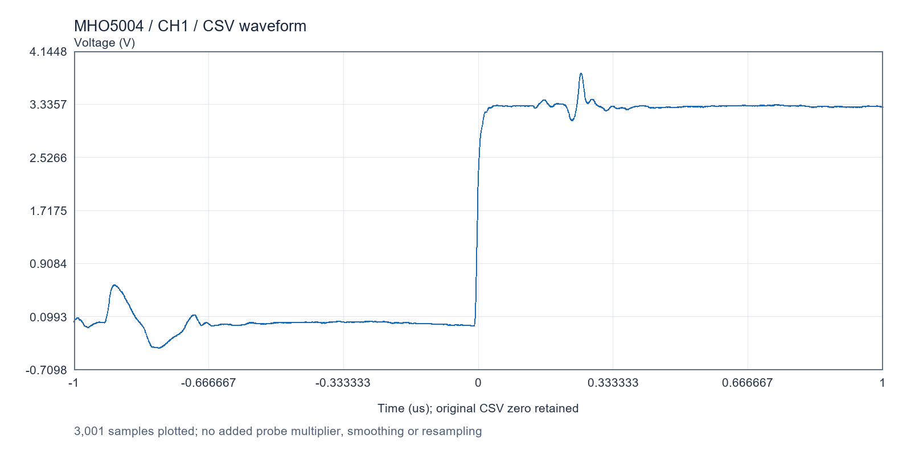

# CSV 波形数据摘要

> 脱敏历史样本预览，不是当前现场采集；仅文件头序列号已替换，采样数值保留。

本表依据本次输入文件生成；时间、电压均采用 CSV 原值。若输入是历史样本，本表也仅描述该历史文件。

## 原始文件

| 项目 | 数据 |
|---|---|
| 型号／序列号 | MHO5004/REDACTED |
| 来源通道 | CH1 |
| 原文件点数 | 180,000 |
| 文件头采样间隔（s） | 6.66666666667e-10 |
| 原文件时间范围（s） | -6e-05 ～ 5.99993333e-05 |
| 原文件电压范围（V） | -0.48 ～ 3.815 |
| 原件 SHA-256 | `082f52697316cabb1d19c2494304085109380ce688edfa1315ff7fe80848ce87` |

## 本次选取

| 项目 | 数据 |
|---|---|
| 请求起点（s） | -1e-06 |
| 请求终点（s） | 1e-06 |
| 实际时间范围（s） | -1e-06 ～ 1e-06 |
| 选取点数 | 3,001 |
| 对应原始样点（从 1 起算） | 88,501 ～ 91,501 |
| 选取电压范围（V） | -0.375 ～ 3.81 |

按原时间列包含两端选点；实际范围以表中结果为准，不保证请求区间全部有数据。未平移零点、重复施加探头倍率、平滑或重采样。完整 CSV 文件不证明全部采集内存、无抽取或绝对精度。

[原 CSV](../../samples/ch1-compensation.csv) · [本次窗口数据](window.csv) · [结构化摘要及哈希](summary.json)
